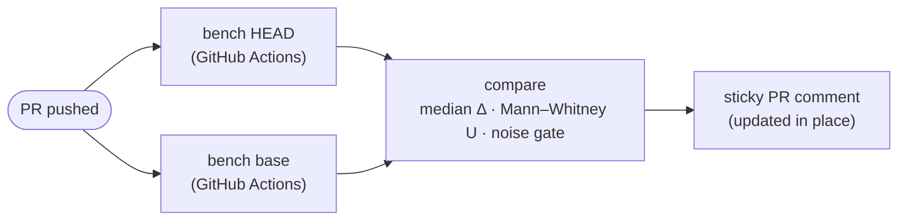

# aatxe

> Catch performance regressions on every pull request — with statistics, not vibes.

**aatxe** benches your code on each PR, statistically compares the change against
its base, and posts a single sticky comment that gates CI when something *actually*
regressed. It speaks **TypeScript, Go, and Rust** through one shared JSON report
format, runs as a **reusable GitHub Actions workflow** downstream repos call in one
line, and ships as a single static binary (`curl … | sh`, or `cargo install`).



**Why you can trust the verdict.** No LLM, no magic instrumentation. A change is
only flagged when the median shift is large enough, statistically significant under
a non-parametric test, *and* clears a noise gate — three independent signals, all
required. Numbers, not opinions. ([methodology](#methodology))

> **aatxe** [/ˈaːtʃe/] — the red-bull spirit of Basque mythology that emerges from
> caves at night to identify and punish wrongdoers. Fitting, for a regression detector.

## Why

* **Polyglot at the boundary.** Aatxe defines a single JSON `RunReport`
  schema; per-language SDKs (`@aatxe/bench` for TS, `aatxe-bench` for Rust,
  the `aatxe` Go module) produce it. The Rust CLI handles comparison,
  rendering, the sticky comment, and the affected-set resolver — the
  *hard* parts only need to exist once.
* **GitHub Actions first-class.** Workflows ship in `.github/workflows/`,
  including a reusable `aatxe.yml` that downstream services can call.
* **Testable end-to-end.** The core (`aatxe-core`) is pure — no IO, no
  globals — every side effect sits behind a trait so tests inject an
  in-memory filesystem and git. The full workspace suite (stats, the
  three-signal verdict, markdown rendering, the affected-set graph across
  all three languages, the GitHub protocol) runs on every PR via
  `make check`.

## Hacking on aatxe

Everything routes through `make`. Run `make help` for the full list; the
load-bearing ones:

```
make check        # cargo fmt --check + clippy -D warnings + every test suite
make test         # only the tests (Rust + Go + TS), no lints
make e2e          # full pipeline (run → compare → report) per language
                  # + regression-gate (synth 30%-slower head, expect exit 2)
make act-ci       # run .github/workflows/ci.yml locally inside Docker via `act`
                  # (requires Docker running)
make install      # `cargo install` the aatxe CLI to ~/.cargo/bin
```

`make e2e` exercises three language adapters back-to-back: it builds the
example runners under `examples/`, executes them through the aatxe CLI,
compares each output against itself, and asserts the rendered markdown
carries the sticky marker. The regression-gate step synthesises a +30%
RunReport pair and pins `aatxe compare --fail-on-regression` to exit 2.

`make act-ci` runs every job from `.github/workflows/ci.yml` inside Docker
with [`act`](https://github.com/nektos/act). On Apple Silicon the workflow
runs under `--container-architecture linux/amd64` against the
`catthehacker/ubuntu:act-latest` image (the Makefile passes those flags
for you). `make act-ci-rust` runs just the heaviest job in isolation.

## Install

One-shot script-install of the latest released binary:

```sh
curl -fsSL https://raw.githubusercontent.com/enekos/aatxe/master/scripts/install.sh | sh
```

By default this drops `aatxe` at `$HOME/.local/bin/aatxe` and verifies
the asset's `sha256` before writing the file. Knobs:

```sh
# Pin a version
AATXE_VERSION=v0.2.0 curl -fsSL https://raw.githubusercontent.com/enekos/aatxe/master/scripts/install.sh | sh

# Install system-wide (needs sudo)
sudo AATXE_PREFIX=/usr/local curl -fsSL https://raw.githubusercontent.com/enekos/aatxe/master/scripts/install.sh | sh

# Skip the checksum (not recommended)
AATXE_NO_CHECK=1 curl -fsSL https://raw.githubusercontent.com/enekos/aatxe/master/scripts/install.sh | sh
```

Alternative install paths:

* **From source.** `git clone … && cargo install --path crates/aatxe`.
* **Cargo.** `cargo install aatxe --locked` from crates.io.

Releases are tag-driven — see `.github/workflows/release.yml` for the
build matrix (darwin-arm64, darwin-x86_64, linux-x86_64, linux-aarch64).

## Quick start

### 1. Write benches in your language of choice

**TypeScript** (`sdk/ts`):

```ts
import { bench } from '@aatxe/bench'
bench('parse: phone', () => parsePhone('+34 612 345 678'))
```

**Go** (`sdk/go`):

```go
import aatxe "github.com/enekos/aatxe/sdk/go"

func main() {
    s := aatxe.NewSuite("my-svc")
    s.Bench("parse_phone", func() { _ = ParsePhone("+34 612 345 678") })
    s.EmitStdout()
}
```

**Rust** (`sdk/rust`):

```rust
use aatxe_bench::{bench, Suite};

fn main() {
    let mut suite = Suite::new("my-svc");
    bench(&mut suite, "parse_phone", || {
        let _ = parse_phone("+34 612 345 678");
    });
    suite.emit_stdout();
}
```

All three SDKs also support **parameterized benches** — one `BenchRun` per
param, named `name/param`, so a regression that only appears at large
inputs reads as a complexity change rather than a constant-factor one:

```ts
// TS — param arrives as the fn's 2nd argument and as setup's 1st:
bench('parse', (_, n) => { keep(parse(inputs[n])) }, { params: [10, 1e3, 1e5] })
```

```go
// Go:
aatxe.BenchParam(s, "parse", []int{10, 1_000, 100_000}, func(n int) {
    aatxe.Keep(Parse(inputs[n]))
})
```

```rust
// Rust:
bench_param(&mut suite, "parse", &[10, 1_000, 100_000], |n| {
    keep(parse(&inputs[n]));
});
```

### 2. Run them locally

```bash
aatxe run --lang ts   --out /tmp/head.json
aatxe run --lang go   --out /tmp/head.json
aatxe run --lang rust --out /tmp/head.json
```

#### Predictable numbers: run in a microVM

Host noise — background load, another core waking, thermal throttling — is the
enemy of a stable bench number. Pass `--isolation microvm` to run the bench
inside an ephemeral [libkrun](https://github.com/containers/krunvm) microVM
instead of on the host: pinned vCPUs, a fixed RAM budget, and a clean rootfs,
so the same code benches the same way twice. One code path on macOS
(Hypervisor.framework) and Linux (KVM).

```bash
make microvm-setup     # one-time: install krunvm (Homebrew on macOS)
make microvm-doctor    # check it's ready

# both bench entry points take the same knobs:
aatxe run     --lang rust --isolation microvm
aatxe perf-vs --against origin/master --isolation microvm
make perf-vs-vm        # shorthand for: make perf-vs ISOLATION=microvm
```

Only the knobs that actually move the numbers are surfaced; everything else
uses libkrun defaults:

| flag (or env) | default | meaning |
|---|---|---|
| `--isolation` | `local` | `local` (host) or `microvm` |
| `--vm-cpus` (`AATXE_VM_CPUS`) | `2` | guest vCPUs |
| `--vm-mem` (`AATXE_VM_MEM`) | `2048` | guest RAM (MiB) |
| `--vm-image` (`AATXE_VM_IMAGE`) | `rust:1` / `golang:1` / `node:22` | guest image (must ship the toolchain) |

The working directory is mounted into the guest at the same path, and the
`cargo` / `go` / `npm` caches persist under `~/.cache/aatxe/vm`, so only the
first run pays the image-pull + cold-build cost. `perf-vs` runs *both* sides
of the A/B in matching guests, keeping the comparison fair.

### 2½. Trial the gate locally — no CI wiring needed

`aatxe baseline save` snapshots a report under `.aatxe/baselines/`
(self-gitignoring), and `aatxe compare --against-local` uses it as the
base side:

```bash
aatxe run --lang ts --out aatxe.json
aatxe baseline save                 # snapshot ./aatxe.json as 'default'
# …edit code…
aatxe run --lang ts --out aatxe.json
aatxe compare --against-local --head aatxe.json --fail-on-regression
```

`--name <n>` keeps several baselines around (one per branch or
experiment); `aatxe baseline list` / `show` / `rm` manage them.

### 3. Compare and post the sticky comment

```bash
aatxe compare --base /tmp/base.json --head /tmp/head.json \
    --threshold 0.05 --alpha 0.05 \
    --markdown /tmp/report.md --out /tmp/cmp.json \
    --fail-on-regression

aatxe comment --report /tmp/report.md   # uses GITHUB_TOKEN + GITHUB_REPOSITORY
```

…or hand everything to the reusable workflow:

```yaml
# .github/workflows/perf.yml in your service repo
jobs:
  perf:
    uses: enekos/aatxe/.github/workflows/aatxe.yml@main
    with:
      lang: ts
      service: my-svc
      affected: true
```

## Methodology

A change is flagged **Regression** / **Improvement** when *all three* hold:

1. `|Δmedian| ≥ thresholdPct` (default 5%) — meaningful effect.
2. `p < alpha` (default 0.05) under Mann–Whitney U — statistically significant
   without any normality assumption.
3. Not noise-gated — `max(CV_base, CV_head) ≤ 25%` *or* `|Δmedian| ≥ 2 × maxCv`.

Effect size uses the **median** rather than the mean: bench distributions
have heavy right tails (GC pauses, scheduler pre-emption) that drag the
mean around. Mann–Whitney U is non-parametric, so it's robust to those
same tails.

See `crates/aatxe-core/src/stats.rs` for the full implementation. The same
algorithm is mirrored in `sdk/ts/src/stats.ts` and `sdk/go/aatxe.go` so a
producer can emit complete reports without the Rust binary in the loop.

## Workspace layout

```
aatxe/
├── crates/                 # four library crates + the CLI, layered so the brain exists once
│   ├── aatxe-core/         # the brain: types · stats · compare · report · affected · github URLs (pure)
│   ├── aatxe-ast/          # tree-sitter symbol/import extraction for TS/Go/Rust (pure)
│   ├── aatxe-evals/        # eval harness — scores the stats engine on synthetic ground truth (pure)
│   ├── aatxe-ui/           # local realtime dashboard (axum + an embedded Svelte build)
│   └── aatxe/              # the CLI binary, organised internally as:
│       #   commands/  subcommand impls          adapter/  per-language bench runners
│       #   github/    ureq REST client          ast/      import-extraction glue
│       #   cli.rs     clap surface
├── sdk/
│   ├── ts/                 # @aatxe/bench  npm package (bench API + runner)
│   ├── go/                 # aatxe Go module (Bench + Suite)
│   └── rust/               # aatxe-bench crate (Suite::bench / Suite::emit_stdout)
├── examples/
│   ├── ts-example/         # smoke bench files for each adapter
│   ├── go-example/
│   ├── rust-example/
│   ├── core-bench/         # microbenches for the aatxe-core statistical brain
│   └── ast-bench/          # microbenches for aatxe-ast tree-sitter parsing
├── evals/
│   └── baseline.json       # committed stats-eval baseline the CI gate diffs against
└── .github/workflows/
    ├── ci.yml                       # builds + tests the workspace (Rust + Go + TS)
    ├── aatxe.yml                    # reusable workflow for downstream services
    ├── aatxe-self-bench.yml         # aatxe gates its own hot code with aatxe
    └── aatxe-evals.yml              # eval harness — baseline-gated on every PR
```

## Subcommands

```
aatxe run       --lang <ts|go|rust> [--out <file>] [--service <name>] [--ref <ref>]
                [--filter <regex>] [--affected --base <ref>] [pattern...]
aatxe compare   (--base <a.json> | --against-local [--baseline-name <n>]) --head <b.json>
                [--out <cmp.json>] [--markdown <md>]
                [--threshold 0.05] [--alpha 0.05] [--noisy-cv 0.25] [--fail-on-regression]
aatxe baseline  save [--report <json>] [--name <n>] | show | list | rm --name <n>
aatxe report    --diff <cmp.json> [--out <md>]
aatxe comment   --report <md> [--repo owner/name] [--pr <num>] [--token <token>]
aatxe affected  --lang <ts|go|rust> --base <ref> [--show-all] [pattern...]
aatxe list      --lang <ts|go|rust> [pattern...]
aatxe perf-vs   --against <ref> [--bench core|ast|all] [--rounds 5] [--fail-on-regression]
aatxe evals     [--out <json>] [--markdown <md>] [--baseline <json>] [--no-fail]
aatxe ui        [--port 4866] [--base HEAD] [--bench core] [--bench-cmd <cmd>]
                [--agent-backend claude|gemini|stub] [--no-open]
```

Exit codes: `0` success, `1` runtime error, `2` regressions detected (when
`--fail-on-regression`).

## Bench coverage

Aatxe benches its own hot code with `aatxe-bench` — the same stats engine
that judges downstream consumers' perf also judges aatxe's. Two self-bench
suites, each emitting a `RunReport` the comparator ingests:

| Suite | Service tag | Covers | Run |
| --- | --- | --- | --- |
| `examples/core-bench/` | `aatxe-core` | `summarize_samples` · Mann–Whitney U · MAD · Welch-t · `compare_reports` · affected import extractor | `make core-bench` |
| `examples/ast-bench/` | `aatxe-ast` | tree-sitter `describe` (Rust/TS/Go) | `make ast-bench` |

`core-bench` and `ast-bench` target the most compute-intensive,
network-free code in the project: the statistical brain that runs on
*every* gate and the tree-sitter parser behind the `--affected` resolver. Workloads are frozen (deterministic PRNG / committed source
snapshots) so the gate doesn't drift.

Each suite has a `*-bench-self` target (`make core-bench-self`, etc.) that
compares its output against itself to prove the render + gate path works,
and the **`aatxe-self-bench.yml`** workflow runs all of them HEAD-vs-base on
every PR and fails the lane on a regression — aatxe gating itself with
aatxe. Locally, `aatxe perf-vs --bench core|ast|all --against <ref>` does the same A/B across a sibling worktree.

## Environment

| Var | Required | Default | Purpose |
| --- | --- | --- | --- |
| `GITHUB_TOKEN` / `GH_TOKEN` | yes | — | PAT or Actions token with `pull-requests: write`. |
| `GITHUB_REPOSITORY` | yes | — | `owner/name` for the PR. |
| `AATXE_PR` / `GITHUB_REF` | (auto) | — | PR number; auto-detected on Actions. |

## Local dashboard (`aatxe ui`)

```bash
aatxe ui                      # serve http://127.0.0.1:4866, open browser
make ui-demo                  # offline demo: stub agent, no LLM
make ui-build                 # rebuild the frontend bundle after editing crates/aatxe-ui/ui
```

A localhost realtime dashboard. The frontend is a **Svelte** app (source
in `crates/aatxe-ui/ui/`, built with Vite); its compiled bundle is
committed under `crates/aatxe-ui/assets/` and baked into the binary with
`include_str!`, so `cargo install aatxe` still ships the whole dashboard
with no Node toolchain at build time — Node is only needed to rebuild the
frontend (`make ui-build`). Three layers, each usable without the next:

1. **Live perf sink.** Any `RunReport` POSTed to `/api/runs`, any
   `perf-vs` run landing in `tmp/perf-vs/`, and any saved baseline in
   `.aatxe/baselines/` streams into the browser as it happens.
2. **Coding agents.** Type a task, hit spawn: the agent works in an
   isolated git worktree on branch `aatxe-ui/<session>-<id>` — never
   your checkout. Three backends via `--agent-backend`: `claude` (the
   local `claude` CLI in print mode), `gemini` (a built-in tool-use loop
   over the Gemini API — `read_file`/`write_file`/`list_files`/
   `run_command`, needs `GEMINI_API_KEY`; `make ui` sources it from
   `GEMINI_ENV`), and `stub` (offline scripted runner). Every time its working tree changes, the bench
   suite re-runs there and the head-vs-base `CompareReport` is pushed
   over SSE: you watch a per-bench median trajectory with the same
   three-signal verdicts the CI gate uses. The base side is benched once
   per session in the shared `perf-vs` worktree. When the agent exits,
   its changes are committed on its branch.
3. **Tournaments.** Spawn K agents on the same task (each gets a
   distinct strategy hint — minimal-diff, performance-first, …) and a
   live leaderboard ranks them by `improvements − 2·regressions`, ties
   broken by net median delta.

Every event is appended to `.aatxe/ui/sessions/<id>/events.jsonl` before
broadcast — refreshing replays the session, and past sessions are
browsable from the rail. Works in any repo with an aatxe SDK via
`--bench-cmd "<command that prints a RunReport JSON>"`.

The claude agent runs with `--permission-mode acceptEdits` and the tool
set `Read Grep Glob Edit Write Bash`; the gemini agent's file tools are
path-confined to the worktree and its `run_command` executes there with
a 120 s timeout. Built with the `ui` cargo
feature (default-on); `cargo install aatxe --no-default-features` for a
slim CLI.

## Evals

Unit tests prove individual functions are correct. Evals prove the
comparator behaves correctly on representative inputs: how often it fires
on identical code, and how often it catches a real regression of a given
size.

```bash
make evals                   # baseline-gated, deterministic, ~2s
make evals-update-baseline   # promote the current run as the new baseline
```

The harness synthesises A/B benchmark pairs with known ground truth —
null, clear and borderline regressions, clear improvement, noise swamping
the signal, below-threshold changes, and between-run drift with one vs
several rounds. Each scenario runs 200 trials with deterministic
SplitMix64 seeds; the scorer reports regression/improvement/neutral rates
per scenario, mean p-value, and whether the configured expectations held.

### CI gate

A baseline JSON lives at [`evals/baseline.json`](evals/baseline.json).
`aatxe evals --baseline …` diffs the current run against it and exits 2
if any headline metric regressed past its tolerance — same exit-code
contract as `aatxe compare --fail-on-regression`. The workflow
[`.github/workflows/aatxe-evals.yml`](.github/workflows/aatxe-evals.yml)
runs on every PR and uploads the JSON + markdown summary as an artefact.

| metric | meaning | direction |
|---|---|---|
| `pass_rate` | fraction of scenarios whose expectations held | must stay 1.0 |
| `observed_null_fpr` | fraction of null-distribution trials the gate fired on | target ≤ α (0.05) |
| `observed_borderline_tpr` | fraction of 6% true-regression trials the gate caught | target ≥ 0.55 |

## License

MIT. See [`LICENSE`](LICENSE).
